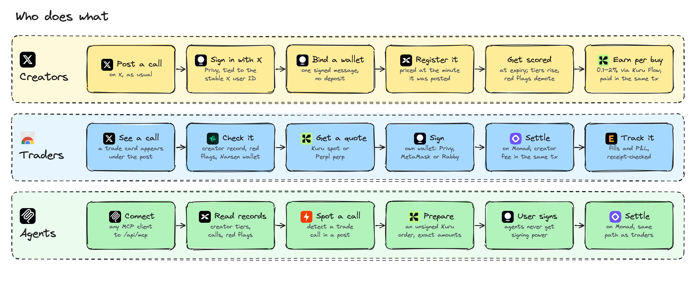
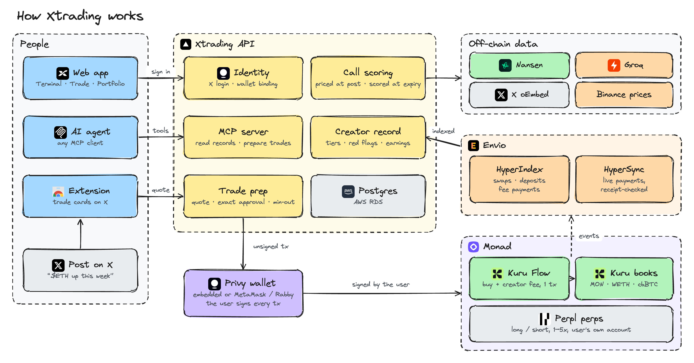

<picture>
  <source media="(prefers-color-scheme: dark)" srcset="docs/assets/logos/xtrading-white.png">
  
</picture>

<br>

**Trade the calls you see on X, and know who's worth following.**  
[xtradingnow.xyz](https://xtradingnow.xyz) · [Chrome extension](https://xtradingnow.xyz/extension) · [Live onchain activity](https://xtradingnow.xyz/dashboard/onchain) · [Product tour](docs/product-tour.md) · [Pitch Video](https://x.com/Xtradingnow/status/2110063504795590952) · [Presentation](https://canva.link/efa8fnb0oxts8vq) · [Agent connector](#plug-in-an-agent)

---

Crypto Twitter runs on calls. Someone posts "$ETH to 3k this week", thousands of people see it, and acting on it means copying a ticker, opening an exchange and hoping the person was right. If they weren't, the post quietly disappears.

**Xtrading closes that gap.** It puts a Buy button directly on the post and the caller's real track record right next to it. Spot trades settle on Monad through Kuru, long and short calls trade as perps on Perpl, creators get paid onchain when people trade their calls, and every number links back to a transaction or a post.

## How it works



### Under the hood



Every part in detail, with a diagram for each (extension, trade routing, Kuru, creator fees, Perpl, scoring, Envio, MCP, website, database): **[Technical overview](docs/architecture.md)**.

## What you can do

The extension, trader dashboard, creator studio and agent access in screenshots: **[Product tour](docs/product-tour.md)**.

### Trade from the timeline

- **One-click trades on X.** The Chrome extension adds a trade card to cashtags and ticker cards inside X. Pick an amount, approve in your wallet, and you're done. You never leave the post. The extension is submitted to the Chrome Web Store and waiting on Google's review; until it's approved, [install it in a minute](https://xtradingnow.xyz/extension) with Load unpacked.
- **Spot on Kuru.** MON, WETH and cbBTC against USDC on Kuru's order books on Monad. Quotes are simulated against the live book, so the minimum output you approve is what the chain will enforce.
- **Perps on Perpl.** When a call is long or short, you can trade it as a perp on Perpl, with leverage and size caps. Testnet by default; mainnet with real AUSD when you pick it and the server enables it.

### Check the caller first

- **Call record.** Creators register their calls within 15 minutes of posting, and the post has to state the asset and direction they register. Each call is priced at the minute it was posted and scored at expiry, so a creator's hit rate and median return come from prices, not screenshots.
- **Red flags.** Xtrading keeps re-checking registered posts and flags any that stop being public. It also flags creators who trade against their own calls and creators who are wrong most of the time.
- **Wallet check by Nansen.** For a creator's linked wallet, Nansen shows whether they actually bought what they told you to buy, or sold into it.
- **Tiers that are earned.** Creators move from Verified to Pro, Max and Ultra as they build a record (for example, Ultra needs 30 scored calls, a 65% hit rate and a positive 7-day median).

### Get paid for good calls

- **Creator fees, settled onchain.** When someone buys from a registered creator's post, a disclosed 0.1–2% fee goes to the creator's verified wallet **in the same Kuru Flow transaction**. There's no invoice, no payout queue and nobody to trust.
- **Earnings you can audit.** Envio indexes every fee payment, and Xtrading checks each one against the chain receipt before it shows up in a creator's earnings.

### Plug in an agent

Tell Claude "long ETH if @cryptorover's latest call is bullish" and it can do the whole thing except sign.

- **Connect.** Add `https://xtradingnow.xyz/mcp` as a custom connector in Claude (or any MCP client that supports OAuth). You sign in with X through Privy once; the connector refreshes its own tokens after that.
- **What the agent can do.** Read a creator's calls and record, classify a post, fetch Kuru and Perpl markets, read your Perpl account, and prepare a Kuru spot trade, a Perpl order, a close or a withdrawal.
- **What it can't do.** Sign. Every trade tool returns unsigned transactions and an approval link. The link opens your wallet (Privy or MetaMask) with the order already filled in, and nothing moves until you approve it there.
- **Testnet unless you say otherwise.** Tools default to Monad testnet; mainnet has to be asked for by chain ID.

Every tool, its inputs and the error codes: [MCP docs](docs/mcp.md). A plain-token endpoint for scripts stays at `https://xtradingnow.xyz/api/mcp`.

## Built with

| Sponsor                         | What it powers in Xtrading                                                                                                                                                                        |
| ------------------------------- | ------------------------------------------------------------------------------------------------------------------------------------------------------------------------------------------------- |
| **[Kuru](https://kuru.io)**     | Spot execution on Monad. Market orders go straight from the wallet to Kuru's order books, and **Kuru Flow** pays creator fees atomically with the buy.                                            |
| **[Privy](https://privy.io)**   | Sign in with X, embedded wallets and transaction signing. Sessions are verified server-side and bound to the stable X user ID.                                                                    |
| **[Envio](https://envio.dev)**  | HyperIndex indexes Kuru swaps, deposits and creator payments. HyperSync powers the live, receipt-checked [onchain activity page](https://xtradingnow.xyz/dashboard/onchain) and creator earnings. |
| **[Nansen](https://nansen.ai)** | Wallet and token intelligence on creator profiles and in the extension, plus price history for scoring calls.                                                                                     |
| **[Perpl](https://perpl.xyz)**  | Perpetuals for long and short calls, traded from the user's own wallet and Perpl account.                                                                                                         |
| **[Monad](https://monad.xyz)**  | Fast enough that trading from a post feels like clicking a button.                                                                                                                                |

How each integration works, with links to the code: [SPONSORS.md](SPONSORS.md).

## Live on Monad

There's no Xtrading contract in the trade path. Spot orders go from the user's wallet straight to Kuru, perp orders straight to Perpl. Xtrading builds the transactions and reads the results back from the chain; it never holds funds or keys.

### Kuru, mainnet

**Contracts**

| Contract                            | Address                                                                                     |
| ----------------------------------- | ------------------------------------------------------------------------------------------- |
| Kuru MON/USDC order book            | [`0x065C…C394`](https://monadvision.com/address/0x065C9d28E428A0db40191a54d33d5b7c71a9C394) |
| Kuru WETH/USDC order book           | [`0xa6aF…D132`](https://monadvision.com/address/0xa6aFD386135B7D41A6C40C525abC4A1019b0D132) |
| Kuru cbBTC/USDC order book          | [`0x40c4…2aF0`](https://monadvision.com/address/0x40c49F171202F91ff5d2faE34c22dD2BFdD22aF0) |
| Kuru Flow entrypoint (creator fees) | [`0xb3e6…13cb`](https://monadvision.com/address/0xb3e6778480b2E488385E8205eA05E20060B813cb) |
| USDC                                | [`0x7547…b603`](https://monadvision.com/address/0x754704Bc059F8C67012fEd69BC8A327a5aafb603) |

**Transactions**

| What happened                                                                                          | Transaction                                                                                                    |
| ------------------------------------------------------------------------------------------------------ | -------------------------------------------------------------------------------------------------------------- |
| Approve USDC for the MON/USDC order book                                                               | [`0xc2de…3514`](https://monadvision.com/tx/0xc2de59ecede3de1db96ae875b103de57d53457fee1a7f8764d3f75a6f84a3514) |
| Buy MON with 1 USDC on Kuru                                                                            | [`0x54a1…13fc`](https://monadvision.com/tx/0x54a19b582bc439194c7eb6d1494b6336e0c5b96d18abdb9d672b8dfa0d6013fc) |
| Sell the MON back to USDC                                                                              | [`0x496c…6d1e`](https://monadvision.com/tx/0x496c1559e65f0086727ab1ca04b92f9ddb80d812b9b1d2421c57981e9ee6db1d) |
| Approve USDC for Kuru Flow                                                                             | [`0x4194…eee8`](https://monadvision.com/tx/0x419458b051d9c744ddb7648d17ccc56c7bf519225ebb8b862f1827395b2deee8) |
| **Buy through Kuru Flow with a 0.1% creator fee paid to the creator's wallet in the same transaction** | [`0x450e…d64c`](https://monadvision.com/tx/0x450e00b927f5b1dc9703b7bbb9fc7ffa52835dfe88ac596632633eb6c1b9d64c) |
| Round trip: approve                                                                                    | [`0x9671…1a71`](https://monadvision.com/tx/0x9671cbe9dbc10cc8880e34d2c9617d64b15fc000404cd246cf304ccb46fc1a71) |
| Round trip: buy MON                                                                                    | [`0x7b3a…92ff`](https://monadvision.com/tx/0x7b3a5f41719f6c0d7611d0d64da497dd50fb3c2f6c7079c103e33fa6a26392ff) |
| Round trip: sell MON (1 USDC in, 0.998845 USDC back)                                                   | [`0x45db…b289`](https://monadvision.com/tx/0x45db923a8a1ee310fd6890df3ad03dd6fcb43cbfcbccf9d3bce5206636c3b289) |

Creator-fee payments are live, receipt-checked, at [xtradingnow.xyz/dashboard/onchain](https://xtradingnow.xyz/dashboard/onchain).

### Perpl, testnet

12 ETH perp orders signed from our own wallets, a Privy embedded wallet and MetaMask, all filled. Each wallet approved an exact AUSD amount, never unlimited.

| Contract                | Address                                                                                             |
| ----------------------- | --------------------------------------------------------------------------------------------------- |
| Perpl exchange          | [`0x1964…80cc`](https://testnet.monadvision.com/address/0x1964c32f0be608e7d29302aff5e61268e72080cc) |
| AUSD (Perpl collateral) | [`0xa901…22dc`](https://testnet.monadvision.com/address/0xa9012a055bd4e0edff8ce09f960291c09d5322dc) |

| What happened                                 | Transaction                                                                                                            |
| --------------------------------------------- | ---------------------------------------------------------------------------------------------------------------------- |
| Privy embedded wallet opens its Perpl account | [`0x6891…bb77`](https://testnet.monadvision.com/tx/0x68918364d2fa53f6e2b21fb65bfe7cdaf1d78c2994079961e267397fc05cbb77) |
| 0.05 ETH long at 3×, filled at 2,503.67 AUSD  | [`0x540d…f68f`](https://testnet.monadvision.com/tx/0x540dc253e038424bf036856b97761a19ad34fed20bd87fe83059b41a0a70f68f) |
| 1 ETH long at 2×, filled at 2,517.28 AUSD     | [`0x3fbc…1ee1`](https://testnet.monadvision.com/tx/0x3fbcb805aac2baf5d9706a18a144a2a55c60746d7d661d390e88a01648ef1ee1) |
| 0.05 ETH long at 3×, filled at 2,511.79 AUSD  | [`0x0d6d…fff4`](https://testnet.monadvision.com/tx/0x0d6d0a23398e8e279bb2f3aaf6ef1624b1126f3c6bf3863692881add5c4bfff4) |

All 12 fills with sizes, prices and blocks: **[Perpl fills](docs/perpl-fills.md)**. Raw receipts for everything above are in [`contracts/deployments/`](contracts/deployments).

<details>
<summary>Kuru testnet contracts</summary>

| Contract                 | Address                                                                                             |
| ------------------------ | --------------------------------------------------------------------------------------------------- |
| Kuru Spot V2 AccountCore | [`0xdbaa…8038`](https://testnet.monadvision.com/address/0xdbaaDe7B42c95399bb1E9614D51B5B9e2cf78038) |
| Kuru MON/USDC            | [`0x26cd…BAc9`](https://testnet.monadvision.com/address/0x26cd68436B6A4AEB3ec52abC20A4d121f8B4BAc9) |
| Kuru WETH/USDC           | [`0x9d18…62F3`](https://testnet.monadvision.com/address/0x9d187971B64505Ac81f12c5FD2ac9c5247Ec62F3) |
| Kuru WBTC/USDC           | [`0x8661…e357`](https://testnet.monadvision.com/address/0x8661cB7c5f4f8ae3ee116B63Aa5a23c69110e357) |

</details>

## Get started

**Use it:** open [xtradingnow.xyz](https://xtradingnow.xyz), sign in with X, and install the [extension](https://xtradingnow.xyz/extension) (Chrome Web Store review is pending with Google, so for now it loads as an unpacked extension). Creators can link a payout wallet at `/creator/earnings`.

**Run it locally** (Node 22+, pnpm 11, Foundry):

```sh
pnpm install
cp apps/web/.env.example apps/web/.env.local   # add Privy, database and RPC values
pnpm indexer:codegen
pnpm dev                                      # http://localhost:3000
```

Configuration, database setup, the indexer, contracts and deployment are covered in [docs/development.md](docs/development.md).

## Repository

| Path                                             | What's inside                                        |
| ------------------------------------------------ | ---------------------------------------------------- |
| [`apps/web`](apps/web)                           | Next.js app, API routes and MCP server               |
| [`apps/extension`](apps/extension)               | Chrome extension (Manifest V3) for X                 |
| [`packages/domain`](packages/domain)             | Shared schemas, scoring and creator tiers            |
| [`packages/integrations`](packages/integrations) | Kuru, Perpl, Nansen, Envio and wallet adapters       |
| [`packages/database`](packages/database)         | Postgres schema and identity service                 |
| [`services/indexer`](services/indexer)           | Envio HyperIndex config and handlers                 |
| [`contracts`](contracts)                         | Foundry tests, including Kuru creator-fee fork tests |
| [`docs`](docs/README.md)                         | Technical overview, product tour and feature notes   |

## What's next

- **Fees tied to results.** Creators should only earn fees after five correct calls that also made money for the people who traded them. That requires matching each user's entry and exit fills to the call.
- **More markets.** More Kuru pairs, and Perpl perps alongside them as its markets grow.
- **Deeper wallet signals.** Show more Nansen context on profiles, for example when a creator's wallet sells into their own call.

## Docs

[All docs](docs/README.md) · [Technical overview](docs/architecture.md) · [Presentation](docs/presentation/Xtrading-presentation.pptx) · [Product tour](docs/product-tour.md) · [Development](docs/development.md) · [MCP server](docs/mcp.md) · [X extension](docs/x-extension.md) · [Identity binding](docs/identity-binding.md) · [Envio demo](docs/envio-demo.md) · [Perpl fills](docs/perpl-fills.md) · [Perpl exits](docs/perpl-exits.md)
