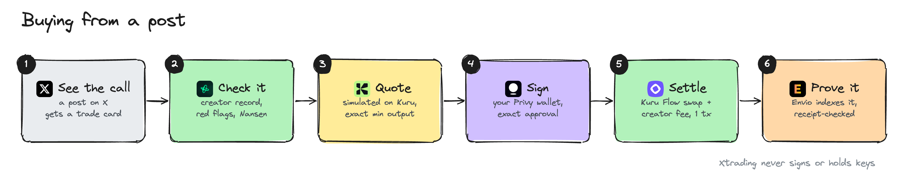
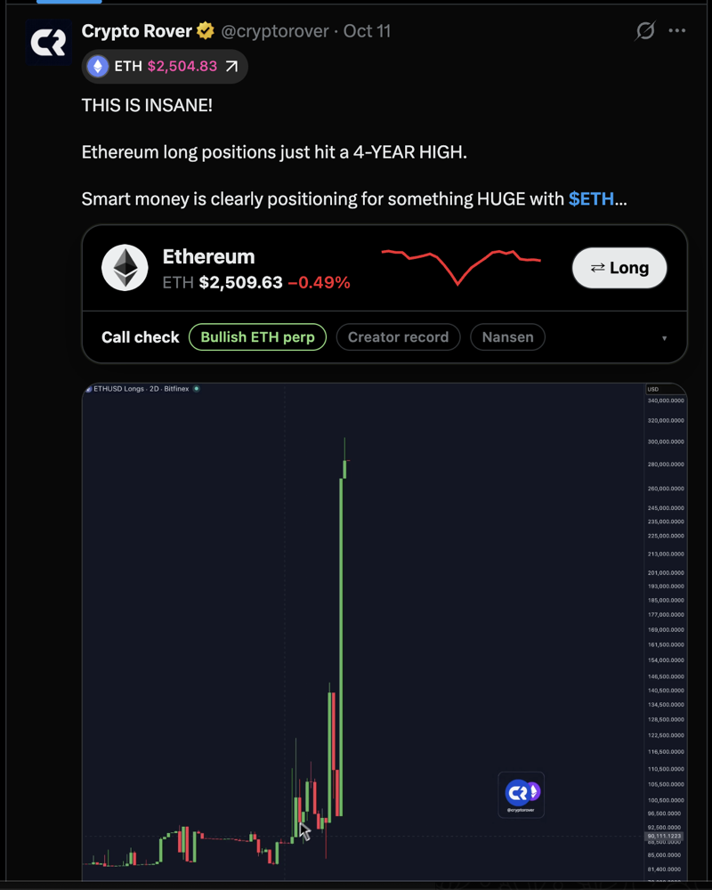
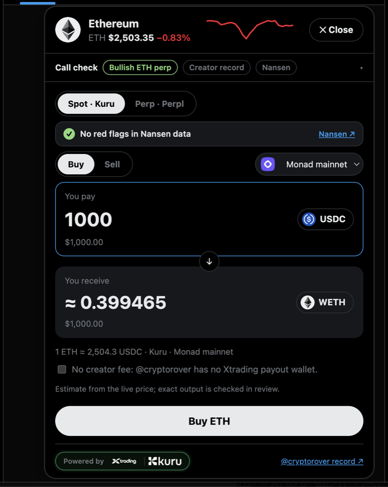
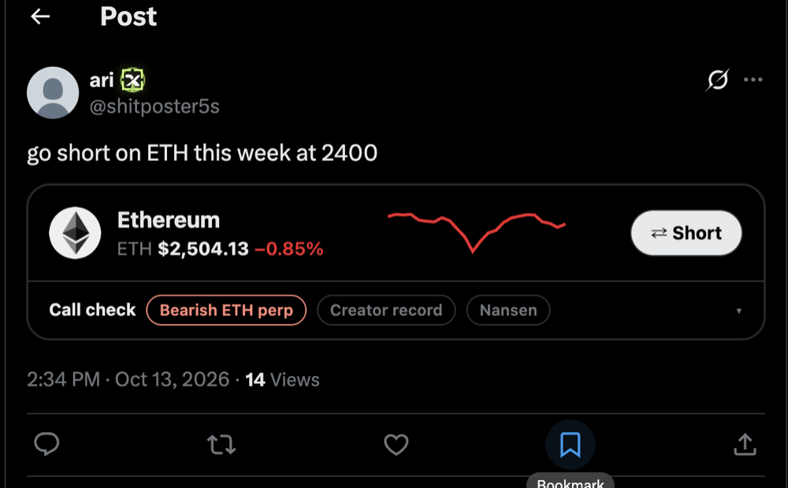
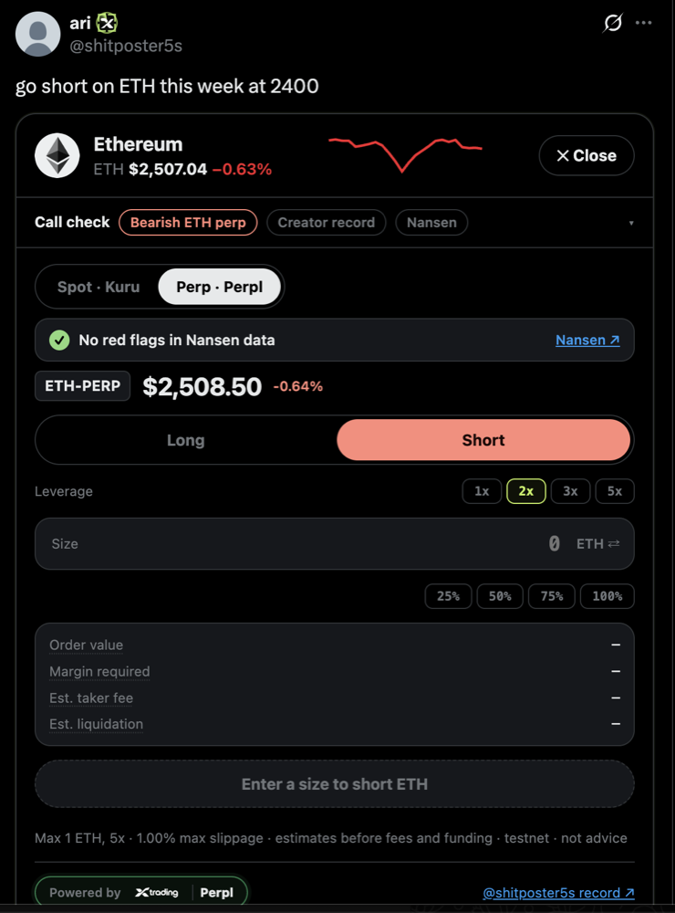
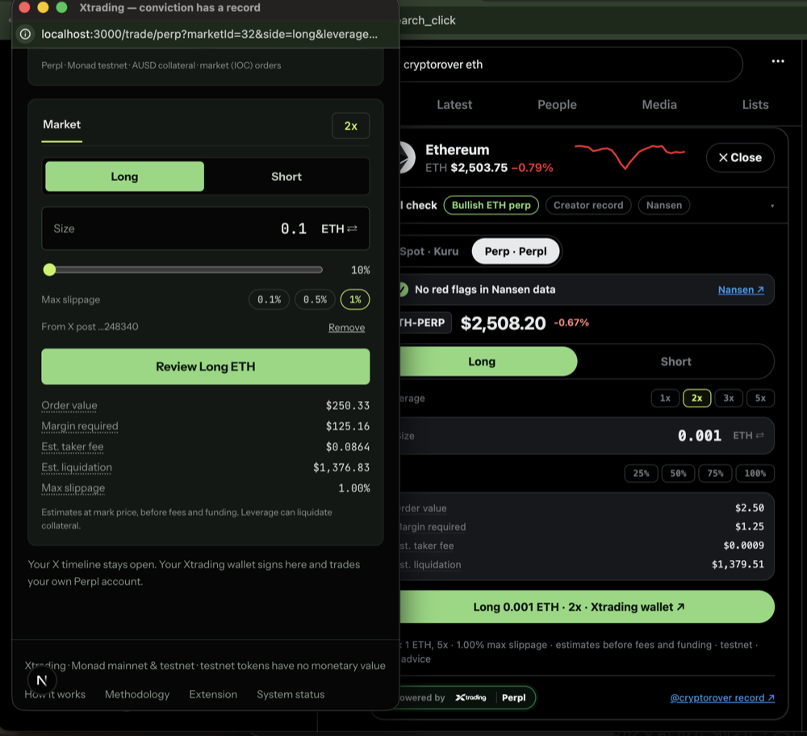
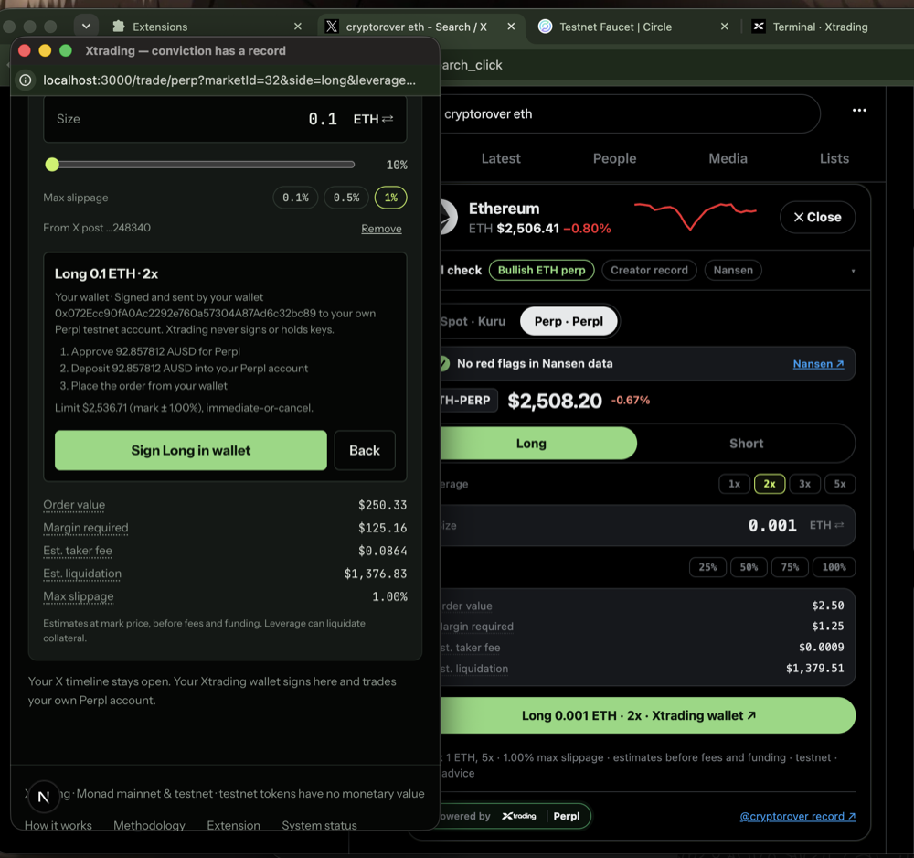
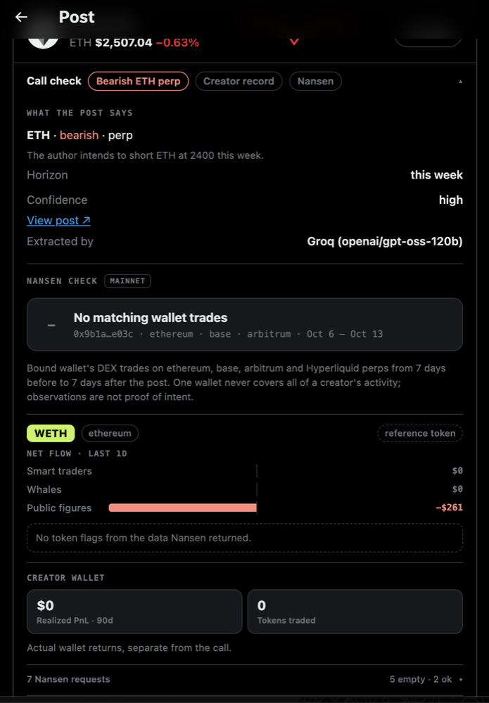
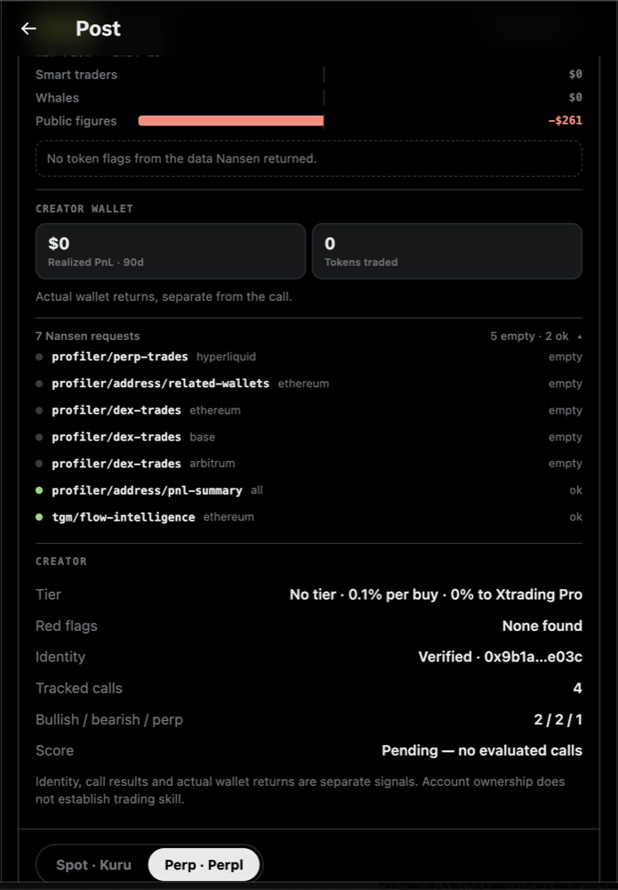
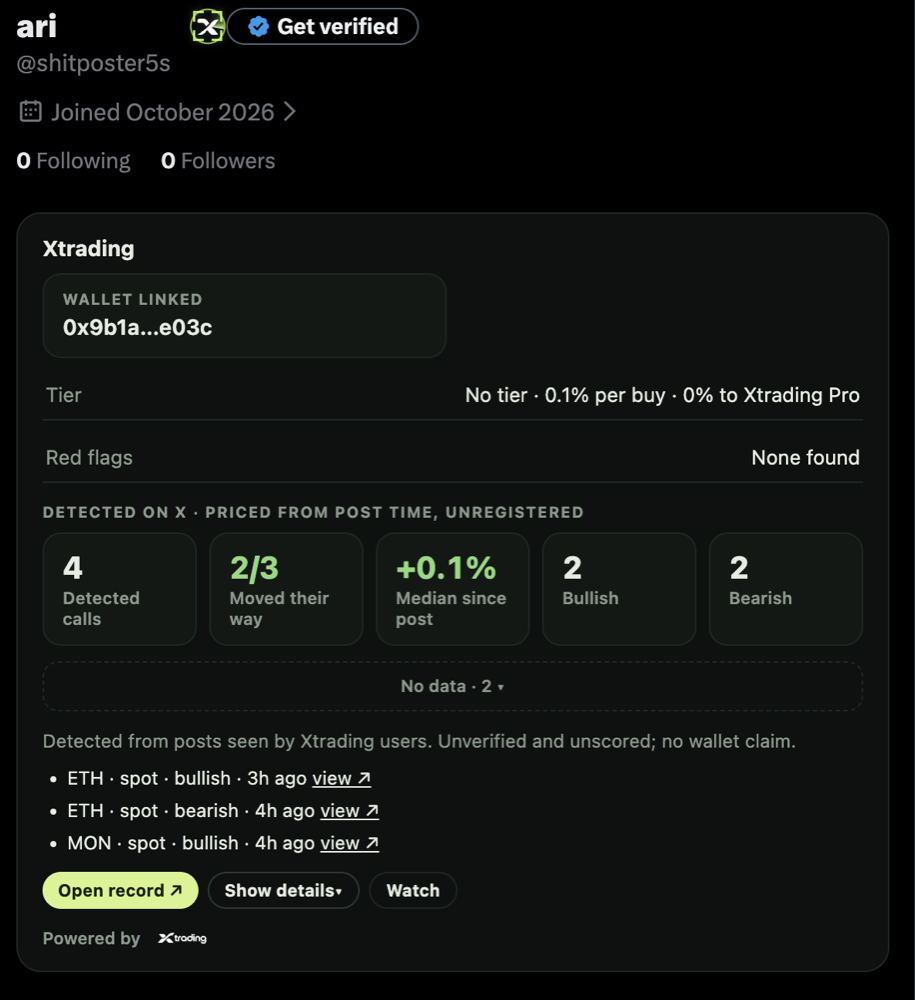

# Xtrading

**Trade the calls you see on X, and know who's worth following.**  
[xtradingnow.xyz](https://xtradingnow.xyz) · [Chrome extension](https://xtradingnow.xyz/extension) · [Live onchain activity](https://xtradingnow.xyz/dashboard/onchain) · [Product tour](docs/product-tour.md)

---

Crypto Twitter runs on calls. Someone posts "$ETH to 3k this week", thousands of people see it, and acting on it means copying a ticker, opening an exchange and hoping the person was right. If they weren't, the post quietly disappears.

**Xtrading closes that gap.** It puts a Buy button directly on the post and the caller's real track record right next to it. Spot trades settle on Monad through Kuru, long and short calls trade as perps on Perpl, creators get paid onchain when people trade their calls, and every number links back to a transaction or a post.

## How it works


### Buying from a post



### Design principles

- **Keys stay with users.** The server prepares exact, bounded transactions and the user signs them. There are no blanket token approvals and no hidden relayers.
- **Identity isn't a track record.** Linking an X account proves you own it. It says nothing about whether your calls make money, so Xtrading keeps identity, call performance and wallet returns separate.
- **Receipts over claims.** A submitted order isn't a fill until the chain says so. Indexed events are checked against receipts and reorgs are rolled back. When a data source is down, the app says so instead of guessing.

## What you can do

More screenshots of the website, trader dashboard, creator studio and agent access: **[Product tour](docs/product-tour.md)**.

### Trade from the timeline

- **One-click trades on X.** The Chrome extension adds a trade card to cashtags and ticker cards inside X. Pick an amount, approve in your wallet, and you're done. You never leave the post.
- **Spot on Kuru.** MON, WETH and cbBTC against USDC on Kuru's order books on Monad. Quotes are simulated against the live book, so the minimum output you approve is what the chain will enforce.
- **Perps on Perpl.** When a call is explicitly long or short, you can trade it as a perp on Perpl, with leverage and size caps.
- **Your wallet, your signature.** Sign in with X through Privy and get an embedded wallet, or bring MetaMask or Rabby. Every transaction is shown to you and signed by you. Xtrading never holds keys and never signs anything.

|                                                                                                          |                                                                                             |
| -------------------------------------------------------------------------------------------------------- | ------------------------------------------------------------------------------------------- |
|  |  |
| A bullish $ETH post gets a Long card right under the text                                                | Buy on Kuru without leaving X                                               |

|                                                  |                                                                                                      |
| ------------------------------------------------ | ---------------------------------------------------------------------------------------------------- |
|  |  |
| "go short on ETH" is read as a bearish perp call | Short ETH-PERP on Perpl with 1–5x leverage and size caps                                             |

|                                                                                                          |                                                                                                |
| -------------------------------------------------------------------------------------------------------- | ---------------------------------------------------------------------------------------------- |
| p- |  |
| Review the order: value, margin, fee and liquidation price                                               | Every step is listed, then signed by your own wallet                                           |

### Check the caller first

- **Call record.** Creators register their calls. Each one is priced at the minute it was posted and scored at expiry, so a creator's hit rate and median return come from prices, not screenshots.
- **Red flags.** Xtrading keeps re-checking registered posts and flags any that stop being public. It also flags creators who trade against their own calls and creators who are wrong most of the time.
- **Wallet check by Nansen.** For a creator's linked wallet, Nansen shows whether they actually bought what they told you to buy, or sold into it.
- **Tiers that are earned.** Creators move from Verified to Pro, Max and Ultra as they build a record (for example, Ultra needs 30 scored calls, a 65% hit rate and a positive 7-day median).

|                                                                                                                    |                                                                                                                                         |
| ------------------------------------------------------------------------------------------------------------------ | --------------------------------------------------------------------------------------------------------------------------------------- |
|  |  |
| Call check: what the post says, the Nansen wallet check and token flows                                            | Every Nansen request is listed, next to the creator's tier, identity and record                                                         |

  
The creator's record appears on their X profile: linked wallet, tier, red flags and recent calls

### Get paid for good calls

- **Creator fees, settled onchain.** When someone buys from a registered creator's post, a disclosed 0.1–2% fee goes to the creator's verified wallet **in the same Kuru Flow transaction**. There's no invoice, no payout queue and nobody to trust.
- **Earnings you can audit.** Envio indexes every fee payment, and Xtrading checks each one against the chain receipt before it shows up in a creator's earnings.

### Plug in an agent

- **MCP server** at `https://xtradingnow.xyz/api/mcp`. Agents can look up a creator's record, detect a trade call in a post, fetch markets and quotes, and prepare a Kuru trade for the user to sign. Agents never get signing power.

## Built with

| Sponsor                         | What it powers in Xtrading                                                                                                                                                                        |
| ------------------------------- | ------------------------------------------------------------------------------------------------------------------------------------------------------------------------------------------------- |
| **[Kuru](https://kuru.io)**     | Spot execution on Monad. Market orders go straight from the wallet to Kuru's order books, and **Kuru Flow** pays creator fees atomically with the buy.                                            |
| **[Privy](https://privy.io)**   | Sign in with X, embedded wallets and transaction signing. Sessions are verified server-side and bound to the stable X user ID.                                                                    |
| **[Envio](https://envio.dev)**  | HyperIndex indexes Kuru swaps, deposits and creator payments. HyperSync powers the live, receipt-checked [onchain activity page](https://xtradingnow.xyz/dashboard/onchain) and creator earnings. |
| **[Nansen](https://nansen.ai)** | Wallet and token intelligence on creator profiles and in the extension, plus MON price history for scoring calls.                                                                                 |
| **[Perpl](https://perpl.xyz)**  | Perpetuals for explicit long and short calls, traded from the user's own wallet and Perpl account.                                                                                                |
| **[Monad](https://monad.xyz)**  | Fast enough that trading from a post feels like clicking a button.                                                                                                                                |

How each integration works, with links to the code: [SPONSORS.md](SPONSORS.md).

## Live on Monad

Xtrading trades directly against Kuru's contracts on Monad. There's no Xtrading contract in the path, so nothing sits between the user's wallet and the order book.

**Contracts**

| Contract                            | Address                                                                                     |
| ----------------------------------- | ------------------------------------------------------------------------------------------- |
| Kuru MON/USDC order book            | [`0x065C…C394`](https://monadvision.com/address/0x065C9d28E428A0db40191a54d33d5b7c71a9C394) |
| Kuru WETH/USDC order book           | [`0xa6aF…D132`](https://monadvision.com/address/0xa6aFD386135B7D41A6C40C525abC4A1019b0D132) |
| Kuru cbBTC/USDC order book          | [`0x40c4…2aF0`](https://monadvision.com/address/0x40c49F171202F91ff5d2faE34c22dD2BFdD22aF0) |
| Kuru Flow entrypoint (creator fees) | [`0xb3e6…13cb`](https://monadvision.com/address/0xb3e6778480b2E488385E8205eA05E20060B813cb) |
| USDC                                | [`0x7547…b603`](https://monadvision.com/address/0x754704Bc059F8C67012fEd69BC8A327a5aafb603) |

**Transactions**

| What happened                                                                                          | Transaction                                                                                                    |
| ------------------------------------------------------------------------------------------------------ | -------------------------------------------------------------------------------------------------------------- |
| Buy MON with 1 USDC on Kuru                                                                            | [`0x54a1…13fc`](https://monadvision.com/tx/0x54a19b582bc439194c7eb6d1494b6336e0c5b96d18abdb9d672b8dfa0d6013fc) |
| Sell the MON back to USDC                                                                              | [`0x496c…6d1e`](https://monadvision.com/tx/0x496c1559e65f0086727ab1ca04b92f9ddb80d812b9b1d2421c57981e9ee6db1d) |
| **Buy through Kuru Flow with a 0.1% creator fee paid to the creator's wallet in the same transaction** | [`0x450e…d64c`](https://monadvision.com/tx/0x450e00b927f5b1dc9703b7bbb9fc7ffa52835dfe88ac596632633eb6c1b9d64c) |
| Round trip: buy MON                                                                                    | [`0x7b3a…92ff`](https://monadvision.com/tx/0x7b3a5f41719f6c0d7611d0d64da497dd50fb3c2f6c7079c103e33fa6a26392ff) |
| Round trip: sell MON (1 USDC in, 0.998845 USDC back)                                                   | [`0x45db…b289`](https://monadvision.com/tx/0x45db923a8a1ee310fd6890df3ad03dd6fcb43cbfcbccf9d3bce5206636c3b289) |

Receipts are stored in [`contracts/deployments/`](contracts/deployments). You can see creator-fee payments live at [xtradingnow.xyz/dashboard/onchain](https://xtradingnow.xyz/dashboard/onchain).

<details>
<summary>Development network contracts</summary>

| Contract                         | Address                                                                                             |
| -------------------------------- | --------------------------------------------------------------------------------------------------- |
| Kuru Spot V2 AccountCore         | [`0xdbaa…8038`](https://testnet.monadvision.com/address/0xdbaaDe7B42c95399bb1E9614D51B5B9e2cf78038) |
| Kuru MON/USDC                    | [`0x26cd…BAc9`](https://testnet.monadvision.com/address/0x26cd68436B6A4AEB3ec52abC20A4d121f8B4BAc9) |
| Kuru WETH/USDC                   | [`0x9d18…62F3`](https://testnet.monadvision.com/address/0x9d187971B64505Ac81f12c5FD2ac9c5247Ec62F3) |
| Kuru WBTC/USDC                   | [`0x8661…e357`](https://testnet.monadvision.com/address/0x8661cB7c5f4f8ae3ee116B63Aa5a23c69110e357) |
| Perpl exchange                   | [`0x1964…80cc`](https://testnet.monadvision.com/address/0x1964c32f0be608e7d29302aff5e61268e72080cc) |
| mUSDC, our demo token (no value) | [`0x7892…6825`](https://testnet.monadvision.com/address/0x78928c53A623585317f9102B88C2d76Df66b6825) |

</details>

## Get started

**Use it:** open [xtradingnow.xyz](https://xtradingnow.xyz), sign in with X, and install the [extension](https://xtradingnow.xyz/extension). Creators can link a payout wallet at `/creator/earnings`.

**Run it locally** (Node 22+, pnpm 11, Foundry):

```sh
pnpm install
cp apps/web/.env.example apps/web/.env.local   # add Privy, database and RPC values
pnpm indexer:codegen
pnpm dev                                      # http://localhost:3000
```

Configuration, database setup, the indexer, contracts and deployment are covered in [docs/development.md](docs/development.md).

## Repository

| Path                                             | What's inside                                        |
| ------------------------------------------------ | ---------------------------------------------------- |
| [`apps/web`](apps/web)                           | Next.js app, API routes and MCP server               |
| [`apps/extension`](apps/extension)               | Chrome extension (Manifest V3) for X                 |
| [`packages/domain`](packages/domain)             | Shared schemas, scoring and creator tiers            |
| [`packages/integrations`](packages/integrations) | Kuru, Perpl, Nansen, Envio and wallet adapters       |
| [`packages/database`](packages/database)         | Postgres schema and identity service                 |
| [`services/indexer`](services/indexer)           | Envio HyperIndex config and handlers                 |
| [`contracts`](contracts)                         | Foundry tests, including Kuru creator-fee fork tests |

## What's next

- **Fees tied to results.** Creators should only earn fees after five correct calls that also made money for the people who traded them. That requires matching each user's entry and exit fills to the call.
- **More markets.** More Kuru pairs, and Perpl perps alongside them as its markets grow.
- **Deeper wallet signals.** Show more Nansen context on profiles, for example when a creator's wallet sells into their own call.

## Docs

[Product tour](docs/product-tour.md) · [Architecture](docs/architecture.md) · [Development](docs/development.md) · [X extension](docs/x-extension.md) · [Identity binding](docs/identity-binding.md) · [Inline trading and creator fees](docs/inline-trading-and-creator-fees.md) · [Envio demo](docs/envio-demo.md) · [Perpl exits](docs/perpl-exits.md)