# Technical overview

How Xtrading is built, one subsystem at a time: what runs where, which data each surface reads, how a post on X becomes a signed trade, and what the server is and isn't allowed to do. Each section links to the code that implements it. For setup and deployment commands see [Development](development.md).

- [The whole system](#the-whole-system)
- [Repository and packages](#repository-and-packages)
- [Ground rules](#ground-rules)
- [Identity and wallet binding](#identity-and-wallet-binding)
- [The X extension](#the-x-extension)
- [From post to route](#from-post-to-route)
- [Spot trades on Kuru](#spot-trades-on-kuru)
- [Creator fees through Kuru Flow](#creator-fees-through-kuru-flow)
- [Perps on Perpl](#perps-on-perpl)
- [Calls, scoring and reputation](#calls-scoring-and-reputation)
- [Onchain data with Envio](#onchain-data-with-envio)
- [MCP server for agents](#mcp-server-for-agents)
- [The website](#the-website)
- [Database](#database)
- [Deployment](#deployment)
- [Known limits](#known-limits)

## The whole system

Three kinds of people use Xtrading: traders on X, creators who post calls, and AI agents acting for a user. All of them go through one Next.js app. The app reads chain state, prices and wallet intelligence, prepares exact transactions, and hands them back to be signed by the user's own wallet. Nothing in the system holds a private key.

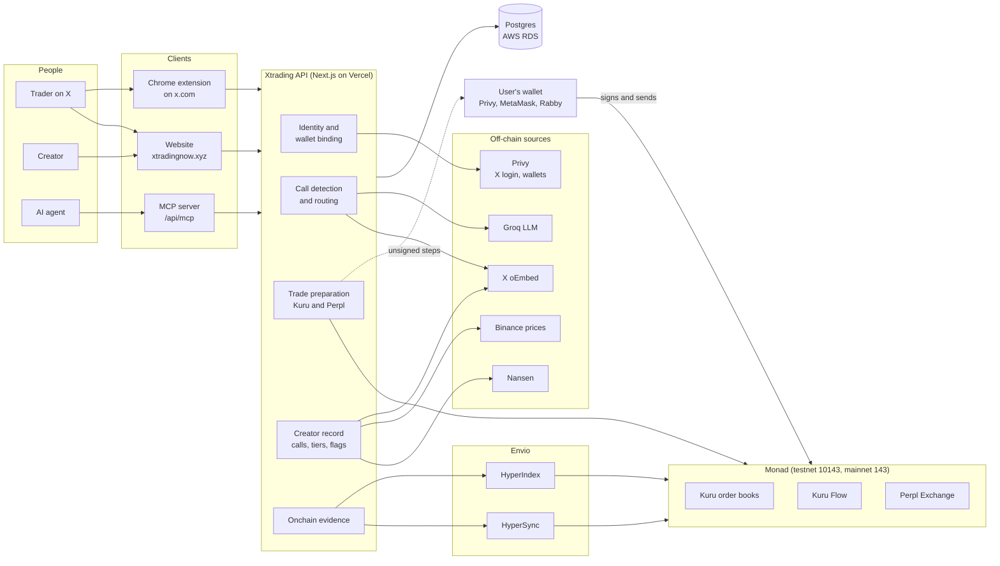

## Repository and packages

A pnpm workspace. Shared logic lives in packages so the website, the extension and the MCP server compute the same thing the same way.

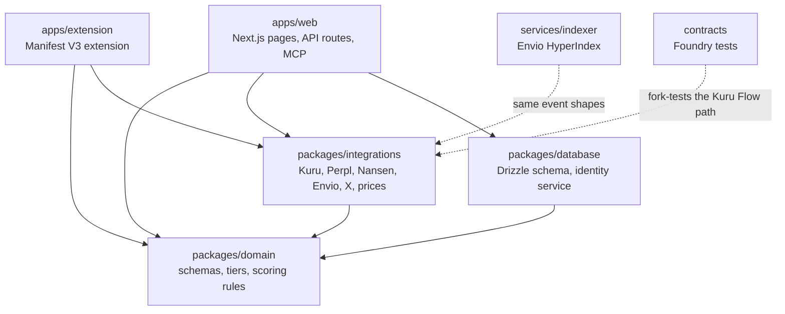

| Path | What's inside |
|---|---|
| [`apps/web/app/api`](../apps/web/app/api) | Every HTTP endpoint, one folder per route |
| [`apps/web/lib`](../apps/web/lib) | Server logic behind the routes (`server-only`) |
| [`apps/web/components`](../apps/web/components) | Dashboard, creator studio, trade review, terminal |
| [`apps/extension/src`](../apps/extension/src) | Content script, service worker, wallet and app bridges, cards |
| [`packages/domain`](../packages/domain/src) | Zod schemas shared by every surface, reputation tiers, watchlist |
| [`packages/integrations`](../packages/integrations/src) | Calldata builders and readers for Kuru, Kuru Flow and Perpl, signal heuristics, Nansen and Envio parsers |
| [`packages/database`](../packages/database/src) | Postgres schema, migrations, nonce-based identity binding |
| [`services/indexer`](../services/indexer) | `config.yaml`, `schema.graphql`, `src/handlers.ts` |
| [`contracts`](../contracts) | Kuru creator-fee fork tests, plus the retired stake and mock-token contracts |

## Ground rules

These hold everywhere and explain most design choices below.

| Rule | How it's enforced |
|---|---|
| The server never signs | Every trade endpoint returns unsigned `{to, data, value}` steps. The user's wallet signs and sends them. |
| Exact approvals only | Approvals are for the exact amount of the next trade, never unlimited. |
| The minimum output is the real one | Kuru minimum output comes from an `eth_call` of the same order at a pinned block, then slippage is applied. |
| Testnet unless mainnet is asked for | Chain `10143` is the default. Mainnet (`143`) must be requested explicitly and enabled on the server (`KURU_MAINNET_ENABLED`, `PERPL_MAINNET_ENABLED`, `CREATOR_FEES_ENABLED`). It never falls back from one network to the other. |
| No floats for money | Amounts are `bigint` or decimal integer strings end to end, including the database (`numeric(78,0)`). |
| Three separate signals | Identity (who owns the account), call record (were the calls right) and wallet activity (what they actually traded) are shown separately and never merged into one score. |
| Honest empty states | A failed provider shows "unavailable", not zero, clean or a guess. Demo fixtures are labelled. |
| Fills come from receipts | A submitted order isn't a fill. Results are read from transaction receipts and indexed events. |

## Identity and wallet binding

Privy handles sign-in with X and embedded wallets. The server verifies the Privy access token on every request and reads the user's linked accounts from Privy itself, never from the browser. Records are keyed by the stable X user ID, so a handle change doesn't break a creator's history.

Trading only needs a Privy login: the wallet must be one Privy lists for that user. Creators additionally bind one wallet to their X account by signing a one-time message. That binding is what payouts, registered calls and the public record use.

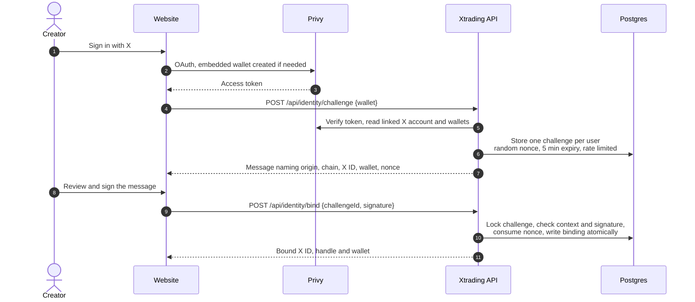

- **Replay:** a challenge can be consumed once; issuing a new one replaces the old nonce.
- **Conflicts:** one X ID, one Privy user and one wallet per binding. A binding cannot silently move to another wallet.
- **Every POST** must come from the configured origin, be JSON and stay under the size limit.

Code: [`identity-auth.ts`](../apps/web/lib/identity-auth.ts), [`identity-http.ts`](../apps/web/lib/identity-http.ts), [`trading-wallet.ts`](../apps/web/lib/trading-wallet.ts), [`identity.ts`](../packages/database/src/identity.ts). More detail: [Identity binding](identity-binding.md).

## The X extension

The extension runs on x.com and twitter.com. It has four parts that talk through narrow, validated messages.

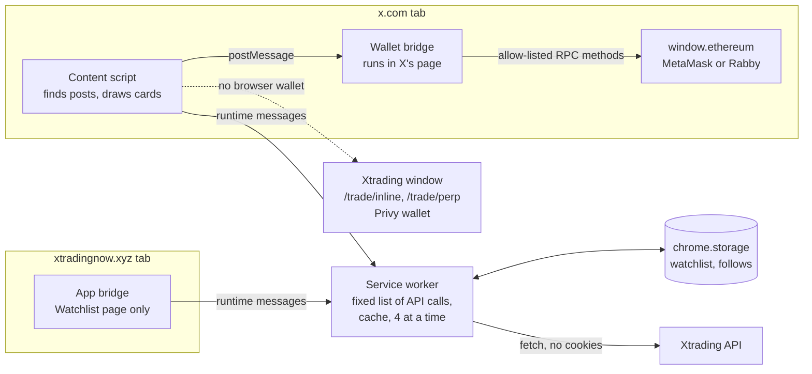

| Part | File | Job |
|---|---|---|
| Content script | [`content.ts`](../apps/extension/src/content.ts) | Watches the timeline, reads each post's ID, author and text, asks for a classification and mounts one card per post. Untrusted text is rendered with `textContent` inside shadow roots. |
| Service worker | [`background.ts`](../apps/extension/src/background.ts) | The only part that calls the API. Accepts a fixed set of message types from X tabs, validates every response with the shared schemas, deduplicates and caches requests, and sends no cookies or tokens. |
| Wallet bridge | [`wallet-bridge.ts`](../apps/extension/src/wallet-bridge.ts) | Runs in X's page where MetaMask and Rabby inject `window.ethereum`, and forwards an allow-listed set of methods (accounts, chain switch, `eth_call`, `eth_sendTransaction`, receipts). Every transaction still needs the user's confirmation in their wallet. |
| App bridge | [`app-bridge.ts`](../apps/extension/src/app-bridge.ts) | Lets the website's Watchlist page read the handles saved from X. Only that page, only that origin. |

### What the content script draws

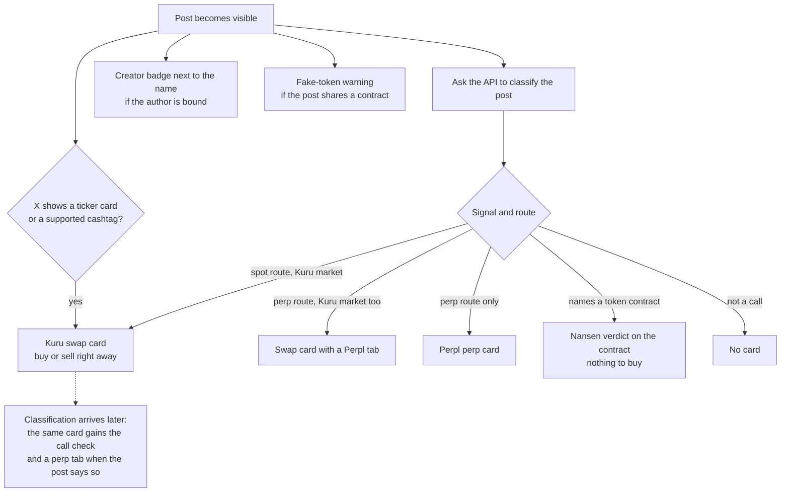

On X profile pages it also adds a creator card (binding, tier, red flags, recent calls) and lets the viewer save the handle to their watchlist. With opt-in, it records which accounts the viewer follows as they scroll their own following list, locally in `chrome.storage`. It never reads X cookies and never calls X's paid APIs.

### How a trade is signed from X

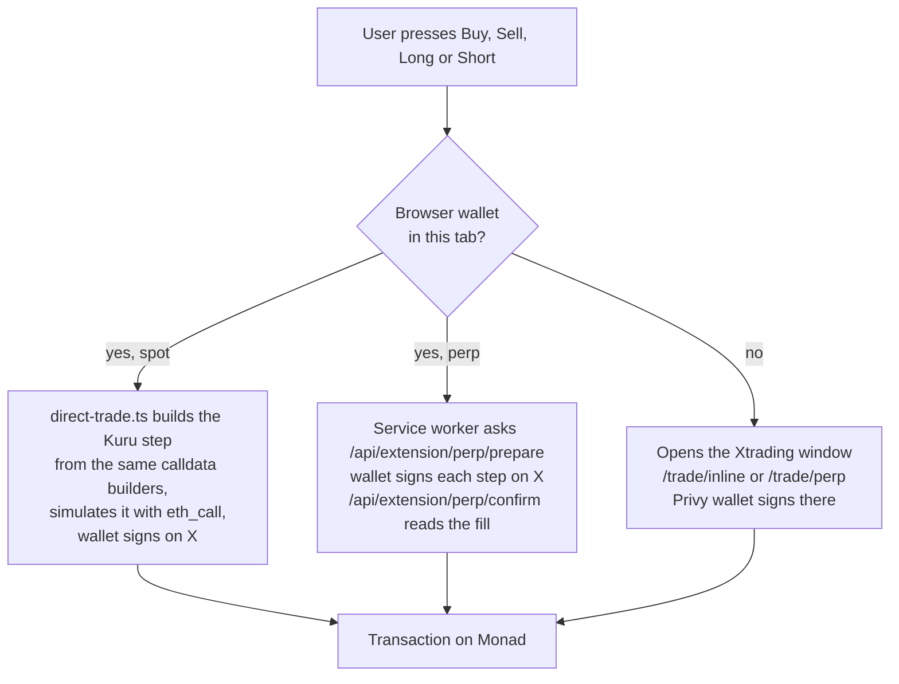

The spot card offers Kuru mainnet and testnet, with mainnet selected. The perp ticket starts on Perpl testnet; mainnet (real AUSD) is an explicit choice and only works when the server enables it. The Xtrading windows trade whichever network the card asked for. Code: [`swap-card.ts`](../apps/extension/src/swap-card.ts), [`direct-trade.ts`](../apps/extension/src/direct-trade.ts), [`perp-ticket.ts`](../apps/extension/src/perp-ticket.ts), [`perp-wallet.ts`](../apps/extension/src/perp-wallet.ts). Product detail: [X extension](x-extension.md).

## From post to route

Detection extracts what a post says. Deterministic code then decides whether there is something to trade. The model never chooses the venue.

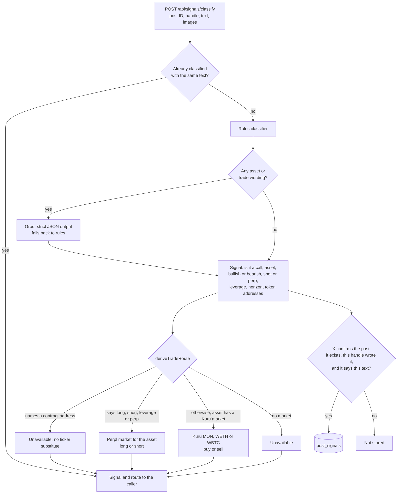

- Bearish wording alone routes to a spot sale, never to a leveraged short. A perp route needs explicit perp wording, whatever the model says.
- A stored post is the first verified version of its text. It feeds the terminal, the detected-call record and the fake-token flags.

Code: [`signals.ts`](../apps/web/lib/signals.ts), [`llm.ts`](../apps/web/lib/llm.ts), [`integrations/signals.ts`](../packages/integrations/src/signals.ts), [`token-references.ts`](../packages/integrations/src/token-references.ts).

## Spot trades on Kuru

Kuru works differently on the two networks, so the app has a step builder for each. Both are exact: one step at a time, re-prepared after each confirmation.

| | Testnet (10143) | Mainnet (143) |
|---|---|---|
| Contracts | Kuru Spot V2: AccountCore and order books | Kuru order books |
| Markets | MON, WETH, WBTC against USDC | MON, WETH, cbBTC against USDC |
| Steps | exact approve to AccountCore, deposit into the Kuru account, swap with a deadline | exact approve to the order book, one immediate-or-cancel market order |
| Minimum output | `eth_call` of the swap at a pinned block, minus slippage | `eth_call` of the market order at a pinned block, minus slippage |
| Market check | price and size precision and token decimals read at that block | the same, plus base and quote tokens and a fee cap |

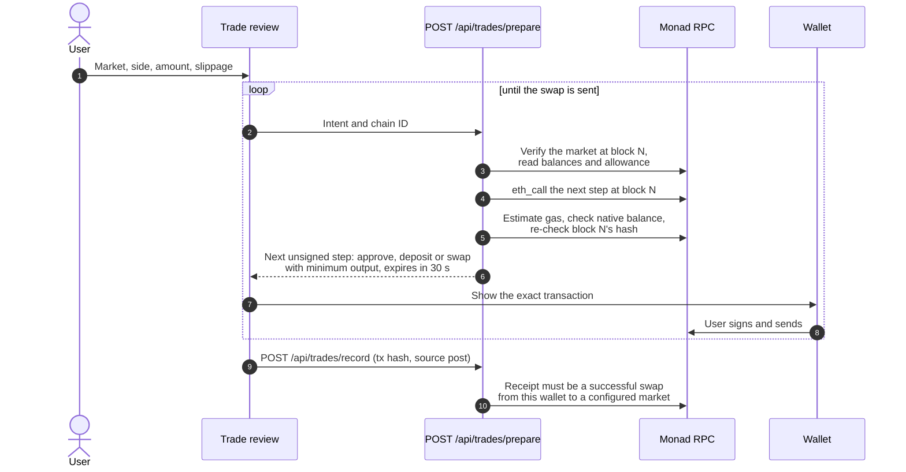

The source post recorded with a trade is the buyer's claim, labelled as such. Code: [`spot-trade.ts`](../apps/web/lib/spot-trade.ts), [`kuru.ts`](../packages/integrations/src/kuru.ts), [`markets.ts`](../apps/web/lib/markets.ts), [`fill-indexing.ts`](../apps/web/lib/fill-indexing.ts).

## Creator fees through Kuru Flow

When someone buys on mainnet from a registered creator's post, the creator's share is paid inside the same transaction through Kuru Flow's referrer fee. If any part fails, the whole buy reverts and nobody is paid.

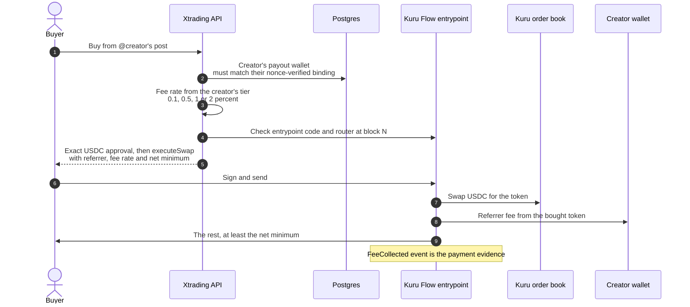

- The buyer sees the rate and can turn the fee off before buying.
- The caller names a creator, never an address. The recipient is resolved from the verified registry.
- Earnings are read back from the `FeeCollected` events (see [Envio](#onchain-data-with-envio)), not from quotes or orders.

Code: [`creator-fees.ts`](../packages/integrations/src/creator-fees.ts), [`creator-payouts.ts`](../apps/web/lib/creator-payouts.ts), [`KuruCreatorFeeFork.t.sol`](../contracts/test/KuruCreatorFeeFork.t.sol).

## Perps on Perpl

Each user trades their own Perpl exchange account from their own wallet. Perpl's `execOrder`, `depositCollateral` and `withdrawCollateral` act on the sender's account, so nothing the server prepares can touch anyone else's.

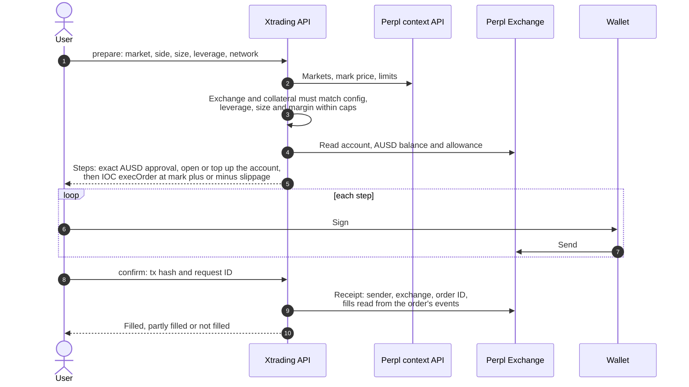

- **Closing** is one reduce-only order whose side and size are read from the chain. **Withdrawing** moves free AUSD back to the same wallet. See [Perpl exits](perpl-exits.md).
- **Testnet** caps: `PERPL_MAX_LEVERAGE` and `PERPL_MAX_SIZE`. **Mainnet** (real AUSD, off unless `PERPL_MAINNET_ENABLED=true`) has its own lower caps: `PERPL_MAINNET_MAX_LEVERAGE`, `PERPL_MAINNET_MAX_COLLATERAL` and optionally `PERPL_MAINNET_MAX_SIZE`.
- Market IDs differ per network. Take them from `/api/markets` (`?perplChainId=143` for mainnet).

Code: [`perpl-exchange.ts`](../packages/integrations/src/perpl-exchange.ts), [`perpl-trade.ts`](../apps/web/lib/perpl-trade.ts).

## Calls, scoring and reputation

There are two kinds of calls, and only one of them sets a creator's tier.

| | Registered calls | Detected calls |
|---|---|---|
| Source | The creator registers one of their own posts | Any post the extension classifies as a call |
| Terms | Asset, direction, horizon (24h, 7d, 30d), minimum move, fixed at registration | Read from the post; timeframe from its wording, 24h when none |
| Prices | Binance (BTC, ETH, SOL), Nansen (MON), at the posting minute and at expiry | The same price sources |
| Used for | **Tiers and fee rate** (methodology `directional-return-v1`) | Terminal ranking and the call check on X. Never tiers. |

### Life of a registered call

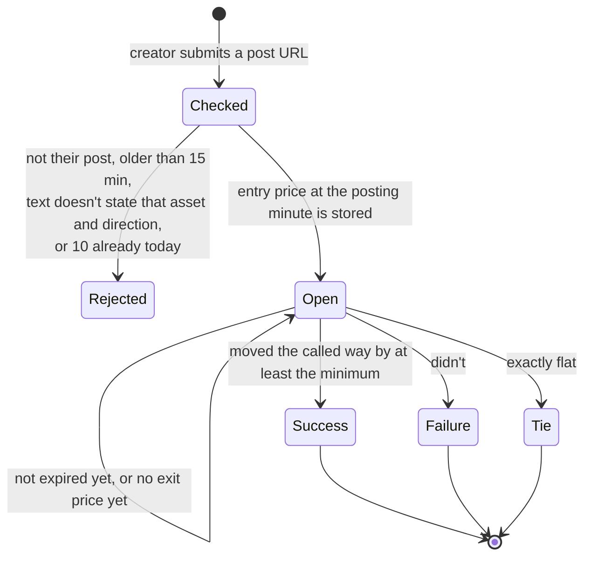

Calls are evaluated when a record is read, a few per request, using the first price candle at or after expiry. The post's public availability is re-checked every six hours. Two misses in a row count as removed.

### From record to tier

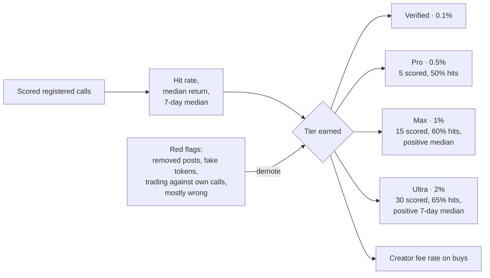

Red flags come from re-checked post availability, Nansen's verdict on contracts the creator shared, and the creator's own indexed swaps. Code: [`calls.ts`](../apps/web/lib/calls.ts), [`integrations/calls.ts`](../packages/integrations/src/calls.ts), [`call-evaluation.ts`](../packages/integrations/src/call-evaluation.ts), [`reputation.ts`](../packages/domain/src/reputation.ts), [`kol-record.ts`](../apps/web/lib/kol-record.ts), [`insights.ts`](../apps/web/lib/insights.ts).

## Onchain data with Envio

Envio supplies the chain history behind activity, earnings and the public onchain page. Two paths, each checked before it's shown.

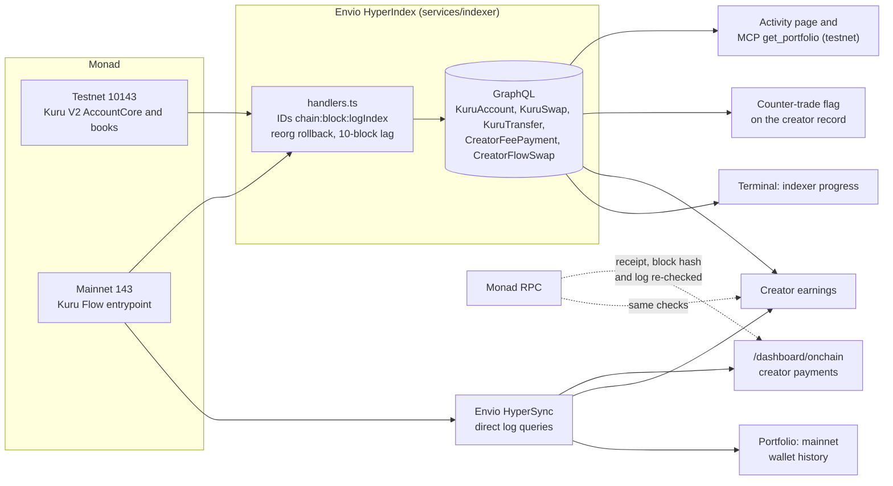

- **HyperIndex** ([`config.yaml`](../services/indexer/config.yaml), [`schema.graphql`](../services/indexer/schema.graphql), [`handlers.ts`](../services/indexer/src/handlers.ts)) indexes Kuru V2 accounts, swaps, deposits and withdrawals on testnet, and Kuru Flow `FeeCollected` and `KuruFlowSwap` on mainnet. The stake events it still indexes are from the retired staking feature.
- **HyperSync** ([`envio-evidence.ts`](../apps/web/lib/envio-evidence.ts), [`envio-events.ts`](../packages/integrations/src/envio-events.ts)) scans `FeeCollected` logs directly. Every event shown is matched against its transaction receipt, block hash and log data from an RPC before display.
- **Freshness:** both paths compare their progress with the chain head and report `current`, `lagging` or `unavailable`. A block lag is not presented as finality.

## MCP server for agents

Agents get the same evidence and trade preparation as the website, but never signing power.

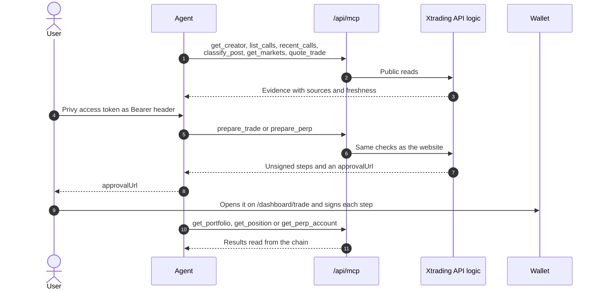

- Stateless Streamable HTTP. Only `POST` is accepted, one server per request, rate limited.
- 13 tools: 6 public, 7 that need the user's session. Mainnet only when `chainId: 143` is passed and the server enables it.

Code: [`mcp.ts`](../apps/web/lib/mcp.ts), [`route.ts`](../apps/web/app/api/mcp/route.ts), [`agent.ts`](../apps/web/lib/agent.ts). Every tool, input and error: [MCP server](mcp.md).

## The website

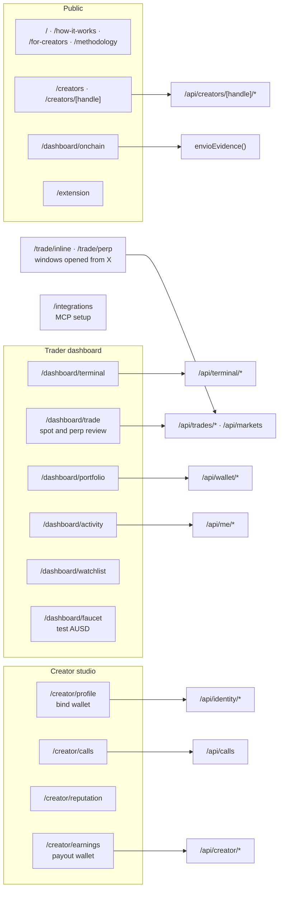

Dashboard pages share a Testnet / Mainnet switch, remembered per browser. A `?chainId=` link overrides it.

## Database

Postgres via Drizzle. Monetary values are `numeric(78,0)` integer token units.

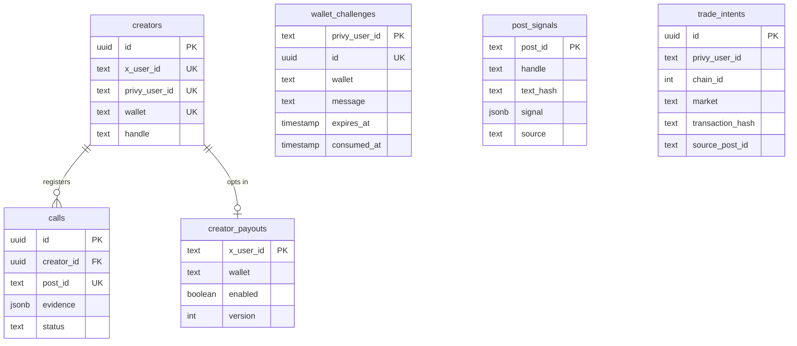

`post_signals` also stores server-added history on each row: availability checks, entry and exit prices for detected calls, and Nansen token verdicts. The `fills` and `stake_snapshots` tables are in the schema but unused by the app. Code: [`schema.ts`](../packages/database/src/schema.ts), [`migrations`](../packages/database/migrations).

## Deployment

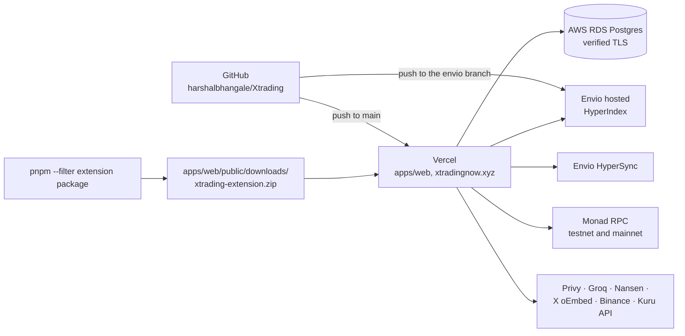

Secrets stay in Vercel's server environment; nothing provider-keyed is `NEXT_PUBLIC_*`. Commands and variables: [Development](development.md#deployment).

## Known limits

- **Source attribution is a claim.** The post a trade is linked to comes from the buyer's link, not from the chain.
- **Coverage.** Detected calls only include posts that Xtrading users have seen on X. The registered-call record only includes posts the creator chose to register.
- **Rate limits are per server instance** and held in memory.
- **The extension's Kuru card defaults to mainnet** and builds trades in the browser, so it doesn't depend on the server's `KURU_MAINNET_ENABLED` switch. Perp tickets default to testnet and need the server's `PERPL_MAINNET_ENABLED` for mainnet.
- **Counter-trade checks** read the creator's indexed testnet Kuru swaps. Mainnet wallet behaviour comes from Nansen.
- **Contract wallets** can't bind yet: binding verifies EOA signatures only.
