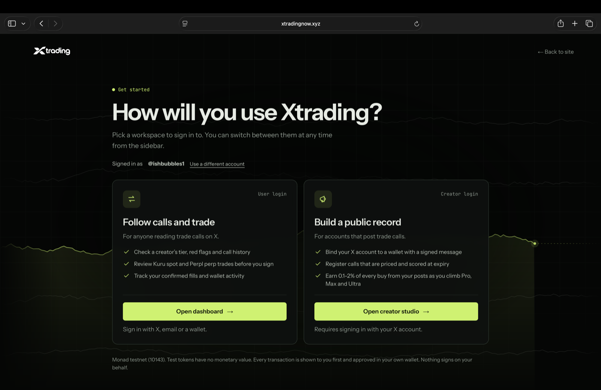
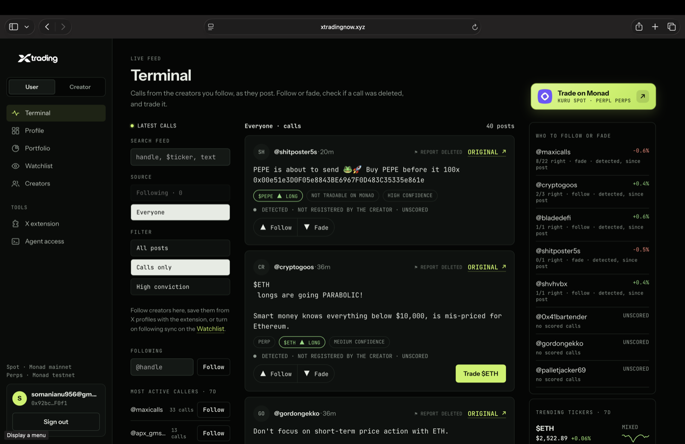
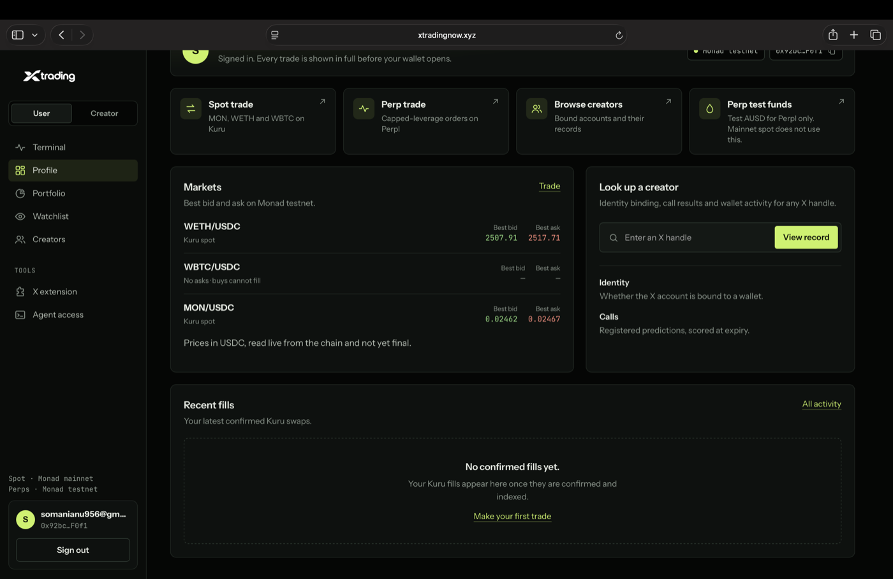
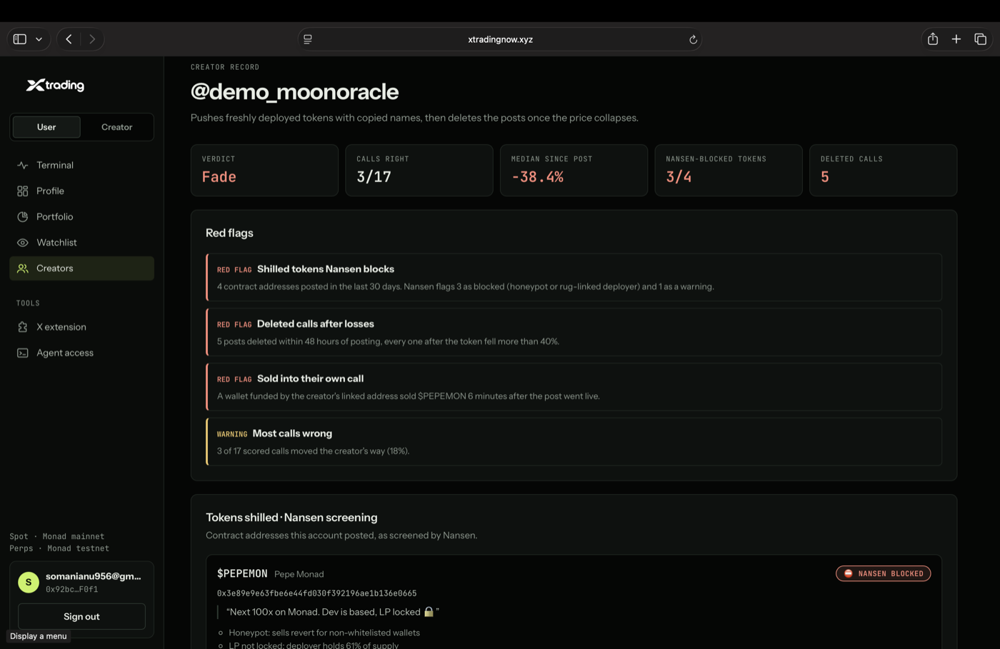
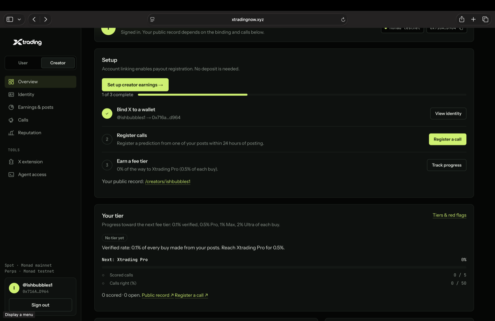
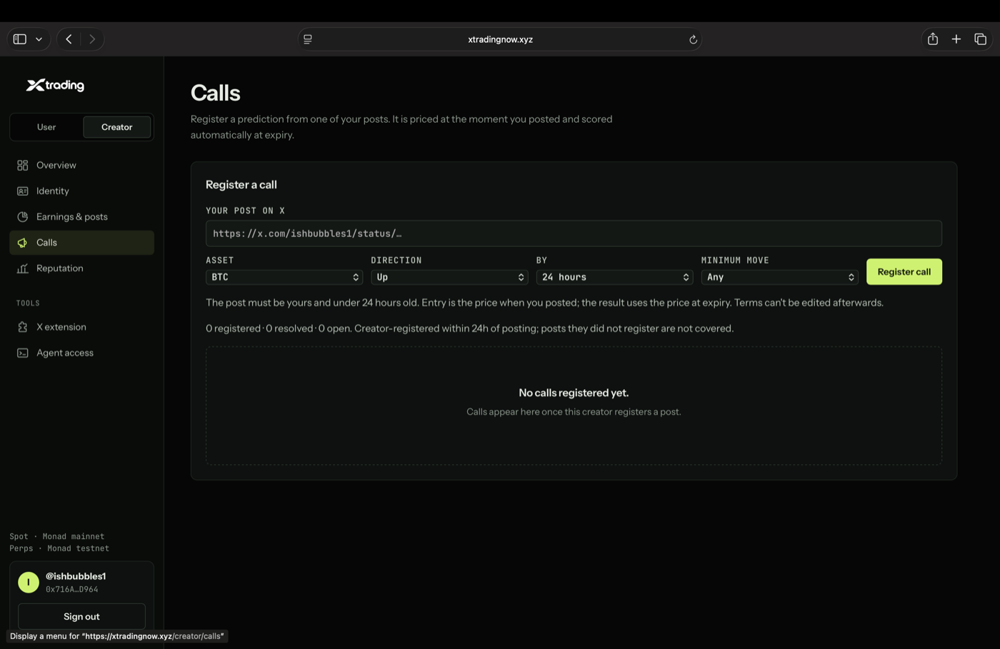
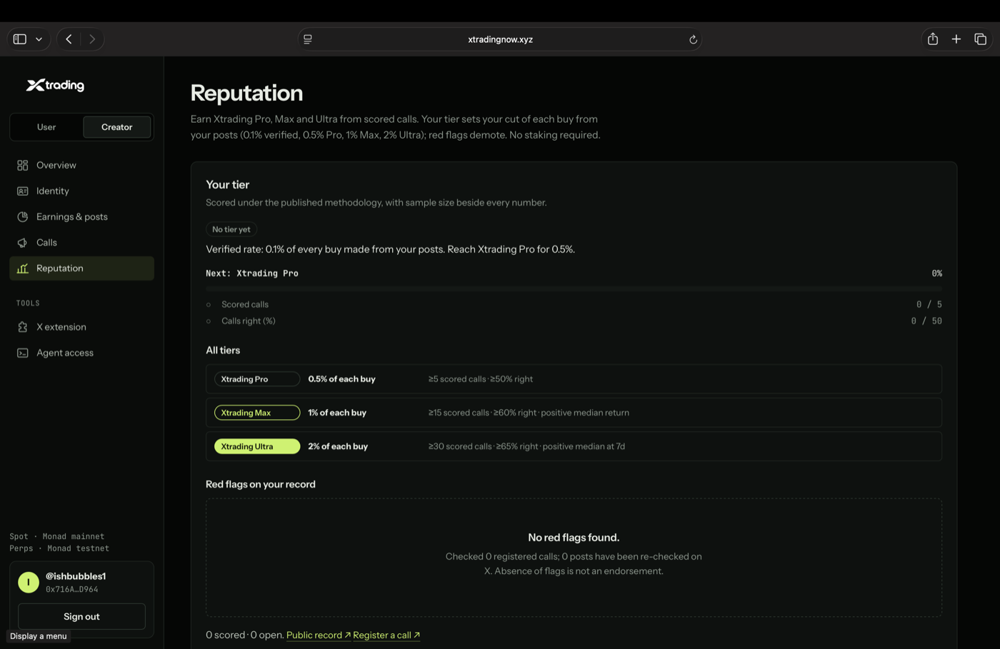
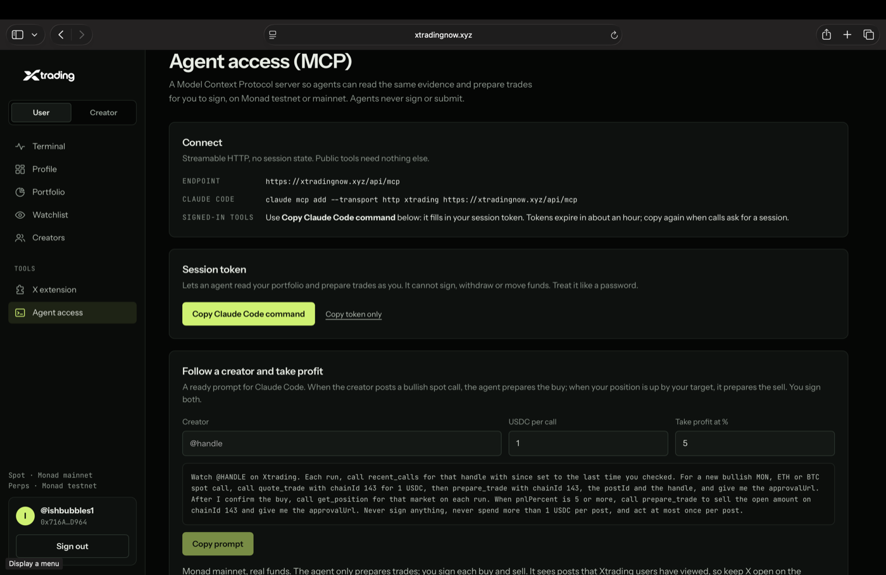
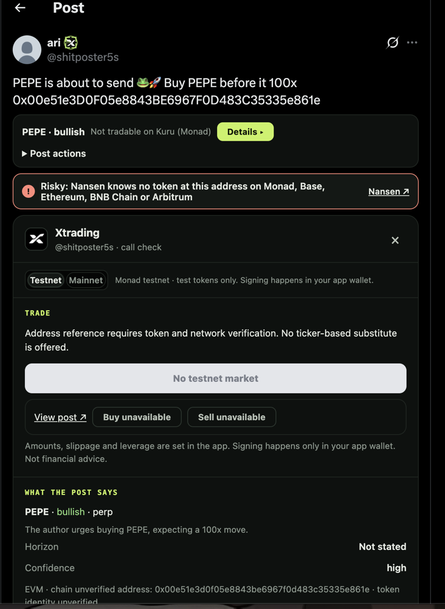

# Product tour

A walk through Xtrading in screenshots: the website, the trader dashboard, the creator studio, agent access and the X extension. Back to the [README](../README.md).

- [Website and sign-in](#website-and-sign-in)
- [Trader dashboard](#trader-dashboard)
- [Creator studio](#creator-studio)
- [Agent access](#agent-access)
- [X extension](#x-extension)

## Website and sign-in

**[xtradingnow.xyz](https://xtradingnow.xyz)**: see the tweet, trade it, stay on X.

**One sign-in, two workspaces.** Traders follow calls and trade. Creators build a public record and earn from buys made from their posts.

## Trader dashboard

**Terminal.** A live feed of calls from the creators you follow, or from everyone. Each post is tagged with its ticker, direction, whether it can be traded on Monad and how confident the extraction is. Follow or fade a call, report a deleted post, or trade it in one click. The right rail ranks who to follow or fade by how often their calls actually moved their way.

**Profile.** Shortcuts to spot and perp trading, best bid and ask on each Kuru market read live from the chain, a creator lookup by X handle, and your confirmed fills.

**Creator record.** Every creator gets a public page with a verdict, hit rate, median move since posting, deleted calls, red flags and Nansen screening of the tokens they shill.

## Creator studio

**Overview.** Setup takes three steps: bind your X account to a wallet with a signed message, register calls, and earn a fee tier. Your public record lives at `/creators/<handle>`.

**Calls.** Paste one of your posts from the last 24 hours and pick the asset, direction, horizon and minimum move. Entry is the price at the minute you posted, the result uses the price at expiry, and the terms can't be edited afterwards.

**Reputation.** Tiers are earned from scored calls and set your cut of each buy: 0.1% when verified, 0.5% at Pro, 1% at Max and 2% at Ultra. Red flags demote you, and no staking is required.

## Agent access

**MCP server.** Connect Claude Code or any other MCP client to `https://xtradingnow.xyz/api/mcp`. Agents can read creator records and your portfolio, and prepare trades for you to sign. They can't sign, withdraw or move funds. The page includes a ready-made "follow a creator and take profit" prompt.

## X extension

### Trade from the post

<table>
  <tr>
    <td width="50%"></td>
    <td width="50%"></td>
  </tr>
  <tr>
    <td>A bullish $ETH post gets a Long card right under the text</td>
    <td>Buy on Kuru without leaving X</td>
  </tr>
  <tr>
    <td></td>
    <td></td>
  </tr>
  <tr>
    <td>"go short on ETH" is read as a bearish perp call</td>
    <td>Short ETH-PERP on Perpl with 1–5x leverage and size caps</td>
  </tr>
  <tr>
    <td></td>
    <td></td>
  </tr>
  <tr>
    <td>Review value, margin, fee and liquidation price</td>
    <td>Every step is listed, then signed by your own wallet</td>
  </tr>
</table>

### Check the caller

<table>
  <tr>
    <td width="50%"></td>
    <td width="50%"></td>
  </tr>
  <tr>
    <td>What the post says, the Nansen wallet check and token flows</td>
    <td>Every Nansen request listed, next to the creator's tier and record</td>
  </tr>
</table>

**Creator card on X profiles:** linked wallet, tier, red flags and recent calls.

### Catching a fake token

A post shills "PEPE" with a contract address that isn't PEPE. Before anyone clicks, the extension puts a Nansen warning right under the post: no chain Nansen covers knows a token at that address. It goes further for well-known tickers: *"The post says PEPE, but this isn't PEPE's contract. The real PEPE is 0x6982…1933 on Ethereum."*

